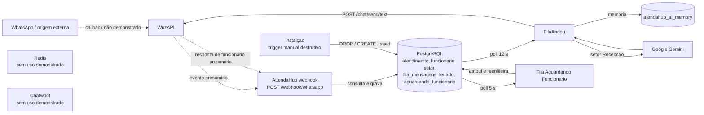

# Arquitetura de automação do AttendaHub

## 1. Escopo e certeza

Fonte principal: quatro exports em Workflows JSON: AttendaHub.json, FilaAndou.json, Fila Aguardando Funcionario.json e Instalçao.json. Esta é uma análise estática; nenhum workflow, serviço, container ou banco foi alterado ou executado. .env não foi aberto.

Todos os quatro exports têm active=false. É um fato dos arquivos, não prova do estado atual da instância nem de que runtime e exports coincidam. Configurações de credenciais dos nós não demonstram conexão válida, database/schema ou permissões. Onde o JSON não é suficiente, a lacuna é indicada.

## 2. Arquitetura e componentes

Os workflows não chamam outros workflows diretamente. Compartilham dados pelo PostgreSQL. n8n recebe o webhook e executa os schedules; PostgreSQL guarda atendimentos e filas; WuzAPI recebe chamadas HTTP para enviar textos; Google Gemini é o modelo ligado ao agente de recepção. O callback da WuzAPI para o webhook não está configurado nos JSON.

| Componente | Papel observado | Limite da evidência |
|---|---|---|
| n8n | Webhook e polling dos workflows. | Exports não confirmam versão/estado atual. |
| PostgreSQL | Atendimentos, funcionários, setores, filas, feriados e memória do agente. | Nós usam credencial postgres; destino/schema não aparecem no JSON. |
| WuzAPI | Envio de texto via HTTP. | URL interna nos nós: http://wuzapi:8080/chat/send/text. Callback externo não provado. |
| Google Gemini | Modelo do agente recepcionista. | Nó aponta para models/gemini-3.1-flash-lite; credencial/disponibilidade não validadas. |
| Redis | Nenhum uso demonstrado nos quatro workflows. | Sem nós ou referência nos JSON. |
| Chatwoot | Nenhum uso demonstrado nos quatro workflows. | Sem nós ou referência nos JSON. |

O Compose do projeto declara n8n, PostgreSQL, Redis e WuzAPI; pastas Chatwoot/Evolution não comprovam serviço ativo. A imagem n8n:latest não fixa versão. Veja AGENTS.md para cuidados de operação.

## 3. Modelo de dados visto no DDL

| Tabela | Uso/campos relevantes |
|---|---|
| setor | ID serial, nome único; seed lista Recepcao (ID 1), Contabilidade, Assessoria, RH e Administracao. |
| funcionario | nome, telefone único, setor_id, status, atendimentos_ativos e timestamps. |
| atendimento | protocolo único, telefone/nome do cliente, setor_id, atendente_id, status e timestamps. |
| fila_mensagens | telefone, mensagem, atendimento_id opcional, tipo, status PENDENTE padrão, timestamps, tentativas e erro. |
| feriado | data única e descrição, consultada na regra de expediente. |
| aguardando_funcionario | telefone, mensagem, atendimento, setor, status AGUARDANDO padrão, timestamps, tentativas e erro. |
| atendahub_ai_memory | tabela declarada no nó Postgres Chat Memory; não criada pelo DDL exportado. |

O DDL não mostra índices explícitos para buscas frequentes por telefone, status ou setor. Não declara idempotência/unique para ID de mensagem. tentativas e erro existem, mas não são usados pelos outros workflows exportados.

## 4. Workflows individuais

### 4.1 AttendaHub.json — entrada e triagem

Export active=false, 28 nós. Webhook aceita POST com path whatsapp. No n8n, o caminho de produção padrão é /webhook/whatsapp; não há autenticação ou resposta customizada expressa no JSON. O export não revela quem chama o webhook.

Filtrar dados importantes faz JSON.parse(body.jsonData), descarta data.type diferente de Message e extrai instanceName, flags IsFromMe/IsGroup, PushName, SenderAlt/Chat, texto, timestamp, tipo, ID, participante e addressingMode. Espera body.jsonData como string JSON. O telefone deriva de SenderAlt ou Chat, divide no primeiro dois-pontos e remove sufixos WhatsApp. messageId, dataHora e outros campos são extraídos, mas não gravados. Catch retorna erro/payload original, sem rota de erro dedicada.

| Nó | Papel |
|---|---|
| Webhook | POST no path whatsapp. |
| Filtrar dados importantes | Analisa evento, extrai campos e normaliza telefone; catch devolve erro e payload. |
| Mensagem minha ou de grupo? | Descarta próprio ou grupo (OR); a outra saída continua. |
| Sticky Note | Nota visual de tipos de mídia; não executável. |
| VerficarNumero | EXISTS em funcionario pelo telefone. |
| É Funcionario | Separa cliente de funcionário. |
| Buscar Funcionario | Busca funcionário pelo telefone e lê status. |
| BuscarAtendimento | LEFT JOIN de funcionário a atendimentos não finalizados, LIMIT 1. |
| EmAtendimento | Testa status do funcionário igual a OCUPADO. |
| Finaliza antendimento? | Compara exatamente com /fim. |
| Finaliza atendimento | Define FINALIZADO e atualiza timestamps. |
| Libera funcionario | Define DISPONIVEL e decrementa contador sem ficar abaixo de zero. |
| Inserir Mensagem a fila1 | Grava /fim como FUNCIONARIO. |
| Inserir Mensagem a fila | Grava mensagem de funcionário como FUNCIONARIO. |
| Switch | Compara /ausente, /iniciar, /encerrar; sem saída padrão. |
| SET Ausente | Define AUSENTE; recebe /ausente e também /encerrar. |
| SET Iniciar | Define DISPONIVEL. |
| Consultar atendimento | EXISTS de atendimento por telefone e status <> FINALIZADO. |
| Em atendimento | Atendimento existente segue à busca; senão segue ao horário. |
| Encontrar atendimento | Busca atendimento, setor e funcionário; LIMIT 1. |
| Gerar protocolo | ATD + data AAMMDD + inteiro aleatório 10000–99999. |
| Criar atendimento | INSERT em atendimento, setor Recepcao, status EM_ATENDIMENTO e sem atendente. |
| Verificar data e hora | Exclui fins de semana/feriados; permite 08:00–11:50 e 13:00–16:50. |
| Horario de atendimento | Em horário verifica texto; fora grava resposta automática. |
| É mensagem de texto? | Compara tipoMensagem com text. |
| Inserir mensagem a fila | INSERT tipo ENTRADA, associada ao atendimento. |
| Inserir mensagem de volte logo a fila | Resposta fixa tipo FORA_HORARIO, atendimento NULL. |
| Inserir mensagem de erro a fila | Resposta fixa de mídia não suportada tipo ERRO, atendimento NULL. |

Fluxo de cliente: verifica atendimento aberto; se não houver, a regra de expediente antecede a checagem de texto. Dentro do horário e para texto, cria atendimento em Recepcao; fora de horário, grava resposta FORA_HORARIO. Mídia não textual durante expediente gera ERRO. A subconsulta do INSERT depende de existir setor Recepcao.

Fluxo de funcionário: /fim só é avaliado se o funcionário está OCUPADO. Não há normalização de texto; comparações são exatas. /encerrar e /ausente levam ambos a AUSENTE. Se funcionário não ocupado, textos que não correspondem aos três comandos terminam sem rota. O ramo /fim finaliza/libera, mas também enfileira literal /fim como FUNCIONARIO.

### 4.2 FilaAndou.json — polling e roteamento

O export local analisado tem active=false e 35 nós. A instância foi consultada via MCP em 2026-11-24: o workflow `FilaAndou`, ID `ozAGOkqCvoOAMrSg`, estava inativo, com 37 nós e atualizado em 2026-11-24. Portanto o export local é anterior e não representa integralmente a configuração observada em runtime. Schedule Trigger roda a cada 12 segundos. ProximaMensagem só seleciona telefone de mensagem PENDENTE criada há pelo menos 15 segundos; agrega todas as pendentes daquele telefone, usando STRING_AGG para texto, ARRAY_AGG para IDs e MIN para ID, atendimento e tipo.

| Nó | Papel |
|---|---|
| Schedule Trigger | Poll a cada 12 s. |
| Get mensagem processando | EXISTS global de status PROCESSANDO. |
| If | Se existe PROCESSANDO, termina; se não, continua. |
| ProximaMensagem | Seleciona pendente elegível mais antiga e agrega por telefone. |
| SET Mensagem Processando | Marca IDs como PROCESSANDO se ainda PENDENTE. |
| Verificar destino | EXISTS em funcionario pelo telefone agregado. |
| E mensagem automatica | ERRO/FORA_HORARIO vão a resposta automática; outros passam pela checagem de funcionário. |
| Enviar mensagem automática | POST do texto agregado à WuzAPI. |
| Atualizar mensagem automatica entregue | Marca IDs como ENVIADA após chamada HTTP. |
| Funcionario em atendimento | Testa booleano encontrado para rotear funcionário/cliente. |
| Responder para cliente | Consulta cliente, setor e funcionário por atendimento_id. |
| Envio ao cliente | Envia mensagem agregada ao telefone do cliente. |
| Atualizar mensagem entregue | Marca IDs como ENVIADA após envio ao cliente. |
| BuscarDadosAtendimento | Consulta atendimento/setor e acrescenta mensagem, tipo e IDs agregados. |
| Atendimento com IA | Setor ID 1 vai ao agente; outros vão ao atendente atribuído. |
| Postgres Chat Memory | Memória Postgres, chave pelo telefone do cliente, tabela atendahub_ai_memory, janela 15. |
| Google Gemini Chat Model | Modelo models/gemini-3.1-flash-lite. |
| Recepcionista | Agente recebe texto; prompt exige JSON acao/setor/confianca/mensagem e setores 1–5. |
| Output para Json | JSON.parse($json.output), sem fallback conectado para parse inválido. |
| Enviar contingência técnica | Node presente na configuração runtime consultada; recebe a saída de erro do Recepcionista e envia mensagem de contingência pela WuzAPI. Usa credencial HTTP Header Auth armazenada no n8n; nenhum token deve ser documentado ou exposto. |
| Marcar contingência enviada | Node presente na configuração runtime consultada; marca os IDs originais como ENVIADA depois do sucesso do HTTP de contingência. Não tem caminho de erro/recuperação automática da WuzAPI; nessa falha as mensagens ficam PROCESSANDO. |
| Setor identificado | acao == ENCAMINHAR encaminha; caso contrário responde ao cliente. Não valida confiança. |
| Resposta recepcao | Envia mensagem do agente ao cliente. |
| Resposta recepcao1 | Envia mensagem do agente ao telefone agregado após ramo de encaminhamento. |
| Atualizar mensagem lida | Marca IDs originais como ENVIADA. |
| Selecionar Funcionario | Busca funcionário atribuído ao atendimento. |
| Enviar Mensagem ao funcionario | Envia texto agregado ao telefone do funcionário. |
| Remover Mensagem da fila | Marca IDs originais ENVIADA após enviar ao funcionário. |
| Atualiza atendimento | Define setor indicado pela IA e status AGUARDANDO_ATENDENTE. |
| Encontra setor disponivel | Busca funcionário DISPONIVEL no setor, ordenando contador e atualizado_em. |
| Funcionario disponivel | Separa ramo disponível/indisponível. |
| Altera setor do atendimento | Define atendente_id. |
| Ocupar funcionario | Define OCUPADO e incrementa atendimentos_ativos. |
| Inserir mensagem da IA a fila | Cria AVISO no telefone do funcionário, mas com texto original do cliente. |
| Mensagen atendententes ocupados | Envia texto fixo ao cliente sobre indisponibilidade. |
| SET augardando atendimento | Atualiza timestamp do atendimento ainda aguardando. |
| Insert fila de aguardando funcionario | Grava texto na fila secundária enquanto status segue aguardando. |

Os nós HTTP usam POST http://wuzapi:8080/chat/send/text. Há cabeçalho chamado token nos exports; seu valor é omitido e sua validade não foi verificada. Alguns envios incluem Id derivado do primeiro ID agregado; o JSON não prova idempotência WuzAPI.

Roteamento: tipo ERRO/FORA_HORARIO envia resposta automática. Telefone de funcionário consulta o atendimento e segue ao envio para o cliente. Telefone de cliente no setor 1 usa Gemini; outros setores usam o atendente atribuído. O prompt pede confiança >= 0,90, mas a condição de encaminhamento testa somente acao.

**Contingência Gemini observada na instância (2026-11-24):** `Recepcionista` está configurado com `retryOnFail`, três tentativas totais (`maxTries=3`) e `waitBetweenTries=3000` ms. Seu `onError` usa a saída de erro (`continueErrorOutput`), conectada a `Enviar contingência técnica`. A chamada HTTP POST à WuzAPI usa credencial do n8n, sem token inline. Somente a saída principal do HTTP segue para `Marcar contingência enviada`, que usa os IDs preservados de `ProximaMensagem` para atualizar a fila original para ENVIADA. Falha no HTTP não alcança esse node e deixa as mensagens em PROCESSANDO, sem recuperação automática. A saída principal do Recepcionista permanece ligada a `Output para Json`; o caminho normal não foi substituído. Não há evidência de execução ou teste desse fluxo durante a implementação. O snapshot local `Workflows JSON/FilaAndou.json` está desatualizado e deve ser atualizado/exportado em tarefa autorizada própria, caso se deseje mantê-lo sincronizado.

**Inconsistência de handoff:** ramo com funcionário disponível cria AVISO endereçado ao telefone do funcionário, mas o corpo é mensagem original do cliente; em seguida envia resposta da IA ao cliente e marca apenas IDs originais como enviados. Na execução posterior, telefone de funcionário segue ao ramo Responder para cliente/Envio ao cliente. O desenho sugere que AVISO pode reenviar ao cliente o texto original em vez de avisar o funcionário.

**Sem funcionário:** envia aviso ao cliente, atualiza timestamp e insere aguardando_funcionario. Nas conexões exportadas não há caminho desse ramo a Atualizar mensagem lida; os IDs originais que já foram marcados PROCESSANDO podem ficar nesse estado.

### 4.3 Fila Aguardando Funcionario.json — distribuição

Export active=false, 10 nós; schedule a cada 5 s.

| Nó | Papel |
|---|---|
| Schedule Trigger | Poll a cada 5 s. |
| Buscar atendimento em espera | Seleciona atendimento AGUARDANDO_ATENDENTE mais antigo. |
| If | Continua se há atendimento_id. |
| Buscar Funcionario disponivel | Busca DISPONIVEL no mesmo setor, ordena por contador e atualização. |
| If1 | Continua se há funcionário; caso contrário termina até próximo poll. |
| Atribuir funcionario | Define atendente e EM_ATENDIMENTO se ainda aguardando. |
| Ocupar funcionario | Define OCUPADO e incrementa contador se ainda DISPONIVEL. |
| Buscar mensagem aguardando | Busca primeira mensagem AGUARDANDO do atendimento. |
| Inserir mensagem na fila | Reinsere como ENTRADA na fila principal. |
| Setar mensagem para processado | Marca mensagem secundária PROCESSADO. |

Seleção, atribuição, ocupação e re-enfileiramento são queries separadas, sem transação explícita ou reserva atômica. Apenas um atendimento global é selecionado por execução; se o mais antigo não tem funcionário disponível, pode bloquear outros setores.

### 4.4 Instalçao.json — instalação e manutenção

Export active=false, 7 nós. Gerenciador DB é Manual Trigger e conecta em Deletar DB → Criar DB → Inserir valores.

**Decisão de desenvolvimento:** preserve este workflow integralmente. Não modifique seus nodes, conexões, parâmetros ou comandos SQL. O `DROP TABLE` é intencional: o desenvolvedor usa esse caminho para reinicializar o banco durante testes quando necessário, portanto não é considerado um bug a corrigir. Qualquer execução continua dependendo de autorização explícita do desenvolvedor. Os outros três workflows podem ser auditados, corrigidos e aprimorados normalmente.

| Nó | Papel |
|---|---|
| Gerenciador DB | Gatilho manual. |
| Deletar DB | DROP TABLE IF EXISTS nas filas, atendimentos, funcionários, setores e feriados. |
| Criar DB | Cria tabelas e relações do DDL. |
| Inserir valores | Insere setores, um funcionário e feriados de 2026. Dados pessoais não reproduzidos. |
| Execute a SQL query1 | Consulta múltiplas tabelas; nó desconectado do caminho do gatilho. |
| atualizar id atendimento | Atualiza uma linha por ID literal para PENDENTE; desconectado. |
| Execute a SQL query | Consulta funcionário por telefone literal; desconectado. |

O caminho manual apaga e recria tabelas. Esse comportamento é intencional para reinicialização do banco durante testes e deve ser preservado; não o trate como defeito nem altere o workflow. A execução exige autorização explícita do desenvolvedor. Esta decisão não autoriza execução automática ou em ambiente com dados.

## 5. Fluxo de mensagens consolidado

1. O webhook do AttendaHub espera POST com body.jsonData como string contendo evento. O serviço que faz callback é externo ao export.
2. Descarta eventos não Message, próprios e de grupo; separa funcionário/cliente por telefone.
3. Cliente com atendimento aberto gera ENTRADA. Sem atendimento, verifica horário. Dentro do horário e com texto, cria atendimento Recepcao e enfileira; fora grava FORA_HORARIO; mídia não textual no expediente grava ERRO.
4. FilaAndou consulta a fila, agrega por telefone, marca PROCESSANDO e roteia resposta automática, recepção IA ou funcionário.
5. Recepção IA usa memória Postgres por telefone e Gemini. Resposta CONVERSA vai ao cliente; ENCAMINHAR atualiza setor e tenta designar funcionário.
6. Sem funcionário, grava a fila secundária. O workflow periódico tenta atribuir, ocupar e devolver mensagem como ENTRADA à fila principal.
7. Resposta de funcionário é presumida como entrada pelo mesmo webhook, gravada FUNCIONARIO e processada para cliente.
8. /fim deve encerrar atendimento e liberar funcionário, mas também é enfileirado como FUNCIONARIO.

## 6. Diagramas Mermaid

### Arquitetura e dependências



### Sequência de mensagem representativa

```mermaid
sequenceDiagram
  participant C as Cliente
  participant W as WuzAPI
  participant A as AttendaHub
  participant DB as PostgreSQL
  participant F as FilaAndou
  participant G as Gemini
  participant E as Funcionario
  participant Q as Fila Aguardando Funcionario
  C->>W: mensagem WhatsApp
  W-->>A: callback presumido; body.jsonData esperado
  A->>DB: consulta/cria atendimento
  A->>DB: insere ENTRADA, ERRO ou FORA_HORARIO
  loop poll da fila a cada 12 s
    F->>DB: seleciona e agrega pendentes por telefone
    F->>DB: marca PROCESSANDO
    alt ERRO ou FORA_HORARIO
      F->>W: envia resposta automática
      F->>DB: marca ENVIADA
    else setor Recepcao
      F->>G: classifica solicitação com memória
      G-->>F: JSON acao/setor/confianca/mensagem
      alt CONVERSA
        F->>W: responde ao cliente
        F->>DB: marca ENVIADA
      else ENCAMINHAR
        F->>DB: atualiza setor e procura funcionário
        alt funcionário disponível
          F->>DB: atribui, ocupa e insere AVISO
          F->>W: envia resposta IA ao cliente
        else sem funcionário
          F->>W: envia aviso de espera
          F->>DB: insere aguardando_funcionario
        end
      end
    else outro setor
      F->>W: envia ao funcionário atribuído
      F->>DB: marca ENVIADA
    end
  end
  loop poll de espera a cada 5 s
    Q->>DB: busca atendimento e funcionário disponível
    Q->>DB: atribui, ocupa e re-enfileira
  end
  E->>W: resposta WhatsApp
  W-->>A: callback presumido
  A->>DB: grava FUNCIONARIO
  F->>DB: identifica funcionário/atendimento
  F->>W: envia texto ao cliente
  F->>DB: marca ENVIADA
```

Os callbacks na sequência são pressupostos funcionais; a configuração não está nos exports.

## 7. Diagnóstico

### Fatos encontrados

- Exports inativos; não equivalem necessariamente ao estado runtime.
- No export local antigo não há o ramo de contingência Gemini; na instância consultada em 2026-11-24, o Recepcionista tem três tentativas totais e ramo de erro para contingência WuzAPI. Os outros nodes HTTP/SQL não tiveram tratamento de falha verificado como parte dessa implementação.
- messageId é extraído, mas não armazenado/deduplicado.
- Bloqueio de PROCESSANDO é global e não há lease/timeout de recuperação visível.
- Caminho sem funcionário não chega à atualização dos IDs originais como ENVIADA.
- Handoff insere AVISO com telefone do funcionário e texto do cliente; telefone de funcionário segue ao ramo de envio ao cliente.
- /fim também entra como FUNCIONARIO.
- SQL usa interpolação direta de valores; DDL não declara índices explícitos nos filtros frequentes.
- `Instalçao` contém `DROP TABLE` conectado ao trigger manual; é comportamento intencional de reinicialização para testes, não um bug a corrigir. Preserve integralmente seus nodes, conexões, parâmetros e SQL; execução exige autorização explícita do desenvolvedor.

### Riscos prováveis, não confirmação de incidentes

- Webhook duplicado pode duplicar mensagens; falhas entre POST e atualização de status deixam entrega ambígua. Idempotência da WuzAPI não foi verificada.
- Linha PROCESSANDO presa pode bloquear todas as mensagens; execuções concorrentes podem observar simultaneamente ausência de processamento.
- Agregação por telefone pode misturar tipos/atendimentos e usa MIN(tipo)/MIN(atendimento_id); mensagens novas podem ser agregadas antes de completarem 15 s.
- Atribuição e reserva do funcionário ocorrem em etapas diferentes; corrida pode deixar atendimentos atribuídos sem funcionário efetivamente reservado.
- Seleção do mais antigo global pode causar bloqueio de cabeça de fila por setor sem funcionário.
- Aspas em mensagens podem quebrar queries; interpolação direta de conteúdo externo traz risco de SQL injection.
- Colisão de protocolo é possível sob UNIQUE sem retry explícito.
- JSON inválido de Gemini pode falhar no parse; confiança solicitada não é validada pelo roteamento.
- Seed de feriados cobre 2026 e não há atualização anual automatizada demonstrada.
- Tabelas podem sofrer scans conforme volume, pois o DDL exportado não cria índices explícitos para os filtros usados.

## 8. Investigação pendente

1. Confirmar workflows ativos e se correspondem aos exports.
2. Confirmar destino/schema, privilégios, índices, constraints e objetos adicionais da credencial PostgreSQL, sem divulgar credenciais.
3. Confirmar callback WuzAPI, URL produção/teste, autenticação e eventos inscritos sem expor tokens.
4. Validar contrato/retorno de /chat/send/text, retry e idempotência de Id.
5. Verificar concorrência, workers, timeout, retries e política de falhas do n8n.
6. Validar credencial/quota do Gemini e comportamento em falha.
7. Confirmar criação e manutenção da tabela atendahub_ai_memory.
8. Verificar consumidores/rotinas externas que atualizam as filas.
9. Confirmar timezone efetivo do PostgreSQL e processo de atualização do calendário de feriados.

Até esses pontos serem verificados, o documento descreve o desenho comprovado pelos exports e não garante o comportamento corrente em produção.

## 9. Estado de implementação e arquitetura de testes (2026-11-24)

Esta seção distingue a arquitetura documentada dos exports locais, o estado observado na instância n8n e as decisões ainda não implementadas. A consulta MCP é uma observação pontual; não equivale a execução nem certifica serviços externos.

### 9.1 Quatro workflows existentes

| Workflow | Responsabilidade conhecida | Estado/evidência |
|---|---|---|
| `AttendaHub` | Receber eventos pelo webhook, identificar cliente/funcionário, aplicar expediente e registrar atendimento/mensagem na fila. | Existe export local; o estado runtime não foi confirmado nesta atualização. |
| `FilaAndou` | Consumir e bloquear mensagens da fila, roteá-las, usar Gemini para recepção e enviar via WuzAPI. | MCP consultado em 2026-11-24: ID `ozAGOkqCvoOAMrSg`, inativo, 37 nodes. O export local com 35 nodes está desatualizado em relação ao runtime. Contém contingência Gemini descrita acima. |
| `Fila Aguardando Funcionario` | Procurar atendimento em espera, atribuir funcionário disponível e reenfileirar mensagem na fila principal. | Existe export local; o estado runtime não foi confirmado nesta atualização. |
| `Instalaçao` (workflow de instalação; export local `Instalçao.json`) | Instalação/preparação do ambiente principal, com DDL e seed. | Deve permanecer integralmente preservado: não alterar nodes, conexões, parâmetros ou comandos SQL. Seu `DROP TABLE` é intencional para reinicialização de testes pelo desenvolvedor, não é bug a corrigir. Toda execução continua exigindo autorização explícita do desenvolvedor. |

Os quatro workflows existentes são independentes em execução e compartilham dados PostgreSQL. O nome escrito pelo desenvolvedor como `Instalação` refere-se ao workflow/export acima, sem criar outro workflow.

### 9.2 Contingência Gemini no FilaAndou: implementada

Na instância consultada, `Recepcionista` está configurado com três tentativas totais, intervalo de 3 segundos e saída de erro. A saída principal continua conectada a `Output para Json`. A saída de erro chama `Enviar contingência técnica`, via WuzAPI com credencial armazenada no n8n, e a saída de sucesso HTTP segue para `Marcar contingência enviada`, que atualiza os IDs originais preservados para ENVIADA. Se a chamada WuzAPI falhar, essa atualização não ocorre e as mensagens continuam PROCESSANDO; não foi criada recuperação automática nessa etapa.

Essa implementação não alterou a seleção/agregação nem o bloqueio global da fila, o caminho normal de sucesso, outros workflows ou o workflow de instalação. A documentação não afirma que o workflow foi executado ou ativado. A cópia local do export ainda não contém os dois nodes novos; não a trate como espelho do runtime.

### 9.3 Banco permanente attendahub_test: planejado, não criado

Decisão aprovada: manter PostgreSQL e seu container, manter banco e dados de produção exatamente como estão e criar um banco independente e permanente `attendahub_test` no cluster existente. Produção e teste deverão ter operações e dados separados. O Compose declara `POSTGRES_DB=chatwoot_production`, mas isso não prova o banco atual de uma instância já inicializada; o nome real ainda precisa ser confirmado de forma somente de leitura, sem revelar senha ou abrir `.env`.

Os exports indicam como estrutura de aplicação as tabelas `setor`, `funcionario`, `atendimento`, `fila_mensagens`, `feriado` e `aguardando_funcionario`; o node Postgres Chat Memory usa `atendahub_ai_memory`, tabela que o DDL exportado de instalação não declara. Antes de escrever migrações é necessário confirmar o esquema requerido pela versão n8n/LangChain efetivamente instalada. Essas tabelas e a memória são requisitos a investigar/preparar no banco de teste; ainda não foram criadas nele.

Estratégia planejada para isolamento:

- Criar `attendahub_test` sem apagar, recriar ou migrar produção, preferencialmente a partir de `template0`, após verificar que o banco-alvo ainda não existe. Não usar o workflow de instalação nem seu `DROP TABLE` para preparar o ambiente de teste.
- Aplicar schema, índices/constraints necessários e migrações versionadas somente quando a conexão estiver explicitamente no banco de teste. Manter histórico/checksum de migrações e não usar reset destrutivo.
- Usar seeds sintéticos e fictícios, idempotentes e sem PII de produção; manter fixtures fora de dumps ou credenciais de produção.
- Validar em runtime `current_database()` e `current_user`, privilégios e referências de conexão antes de qualquer migração/teste. Serializar o bootstrap para evitar corridas de criação.
- Impedir no próprio PostgreSQL conexões da role de testes à produção, além da separação por credenciais. A proposta é usar regras específicas e ordenadas em `pg_hba.conf` para permitir a role de execução somente em `attendahub_test` e rejeitar seus demais bancos; revisar regras existentes, origem de rede e banco de manutenção antes de aplicar. `REVOKE CONNECT` isolado não basta se `PUBLIC` continuar com CONNECT. Nenhuma regra foi alterada.
- Configurar Postgres Chat Memory no workflow de testes com a credencial restrita ao banco de teste e tabela de memória própria desse ambiente; nunca reutilizar credencial de produção. Confirmar o schema da memória antes de criar objetos manualmente.

O n8n tem uma credencial PostgreSQL atual cuja configuração não foi exposta nesta atualização. MCP não confirmou seu nome de banco; isso permanece pendente. O `POSTGRES_DB` do Compose é apenas valor de inicialização e não substitui verificação read-only da credencial/servidor.

### 9.4 Workflow quinto e três credenciais PostgreSQL: planejados

Foi decidido centralizar no novo workflow `AttendaHub - Testes Automatizados` a verificação/criação do banco, preparação de estrutura, aplicação de migrações, atualização de seeds fictícios, validação de isolamento, execução de cenários e apresentação dos resultados. O workflow ainda não foi criado. O workflow `Instalaçao` continua independente e dedicado exclusivamente à instalação/preparação do ambiente principal.

Estratégia de três credenciais separadas no n8n:

| Credencial planejada | Conexão/uso | Privilégio esperado |
|---|---|---|
| Bootstrap/criação | Banco de manutenção cuja identidade não produtiva seja confirmada; usada somente pelo estágio que verifica/cria `attendahub_test`. | Role administrativa sem superuser; `CREATEDB` é privilégio de cluster e não limita por si só a criação a um único nome. Restringir bancos acessíveis no servidor e não permitir essa credencial nos nodes de cenários. |
| Preparação/migração | Diretamente conectada a `attendahub_test`; schema, ledger de migrações e seeds. | Role preparadora com privilégios de DDL apenas dentro do banco de teste e sem `CREATEDB`/superuser. |
| Execução de testes | Diretamente conectada a `attendahub_test`; nodes de cenários, asserts e memória Postgres Chat Memory. | Role exclusiva de execução, sem `CREATEDB`, superuser ou DDL; apenas CONNECT/USAGE e DML estritamente necessários nos objetos de teste. Regras do PostgreSQL também devem negar acesso a produção. |

O workflow terá etapas separadas e guardas explícitas: (1) preflight de alvo/credenciais; (2) existência e bootstrap do banco usando somente credencial de criação; (3) migrações/seeds usando a credencial preparadora conectada ao banco de testes; (4) teste de isolamento com a credencial de execução e verificações de identidade/privilégios; (5) cenários usando apenas a credencial de execução e integrações externas isoladas ou simuladas; (6) agregação e relatório sanitizado. O criador do banco é privilegiado e nunca deve ser referenciado por nodes de cenário. Se a credencial PostgreSQL do n8n fixa um database por conexão, a etapa de criação precisa conectar a um banco de manutenção e as etapas seguintes usar conexões distintas para `attendahub_test`.

Migrações e seeds deverão ser versionados em diretório dedicado do projeto (por exemplo `db/test/migrations/` e `db/test/seeds/`), com instruções e checksums. O mecanismo de leitura/aplicação pelo n8n (arquivos montados somente para leitura ou SQL mantido explicitamente no workflow) ainda precisa ser escolhido. Esse planejamento não autoriza alterações no Compose, montagem de volumes, arquivos, credenciais, PostgreSQL ou workflows.

### 9.5 Matriz do que existe e do que falta

| Item | Situação em 2026-11-24 |
|---|---|
| Quatro workflows principais e suas responsabilidades | Existem como exports locais; para `FilaAndou` há estado runtime MCP observado e divergência de 2 nodes. |
| Retry e contingência Gemini no `FilaAndou` | Implementados e observados no runtime; workflow inativo na consulta. Não executar/ativar sem autorização. |
| Preservação integral de `Instalaçao` | Decisão vigente; o workflow não foi alterado nesta atualização documental. |
| Banco permanente `attendahub_test` | Apenas planejado; não criado. |
| Role de criação, role migradora, role de execução e regras de isolamento | Apenas planejadas; não criadas/aplicadas. |
| Três credenciais PostgreSQL no n8n | Apenas planejadas; não criadas. |
| Migrações, seeds fictícios e schema de memória do teste | Apenas planejados; não criados. |
| Workflow `AttendaHub - Testes Automatizados` | Apenas planejado; não criado nem executado. |
| Alterações de containers, banco ou Compose para infraestrutura de teste | Nenhuma realizada. |
