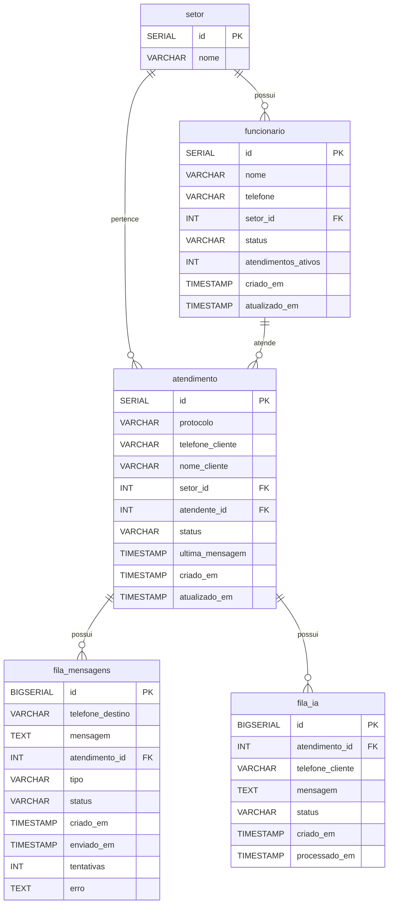

Acessos:
N8N : http://localhost:5678/

C:\Users\Moosh>curl -X PUT http://localhost:8080/webhook -H "token: token" -H "Content-Type: application/json" -d "{\"webhook\":\"https://duvet-junkyard-stumbling.ngrok-free.dev/webhook-test/whatsapp\",\"events\":[\"Message\"],\"active\":true}"
{"code":200,"data":{"active":true,"events":["Message"],"webhook":"https://duvet-junkyard-stumbling.ngrok-free.dev/webhook-test/whatsapp"},"success":true}

C:\Users\Moosh>curl -X GET http://localhost:8080/webhook -H "token: token"
{"code":200,"data":{"subscribe":["Message"],"webhook":"https://duvet-junkyard-stumbling.ngrok-free.dev/webhook-test/whatsapp"},"success":true}

